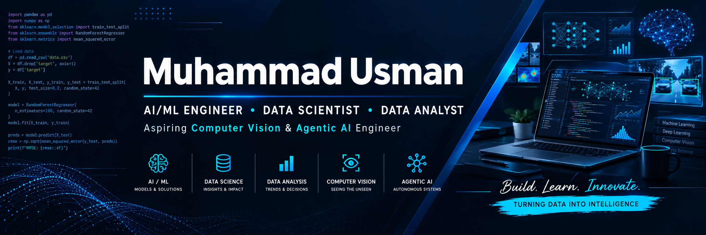

<!-- Add your banner image at assets/github-banner.png -->

  

<h1 align="center">👋 Hi, I'm Muhammad Usman</h1>

  

  
  
  

---

## 👨‍💻 About Me

I'm **Muhammad Usman**, an AI/ML Engineer and Data Science professional passionate about developing practical, data-driven solutions and intelligent systems.

My interests include machine learning, data analytics, predictive modeling, time-series forecasting, Agentic AI, and computer vision. I enjoy exploring new technologies, working on research-oriented projects, and turning ideas into practical applications.

- 🔭 Currently working on: Pakistan Air Quality Forecasting
- ✈️ Research work: Aircraft Engine Remaining Useful Life (RUL) Prediction
- 📝 Recently wrote a research paper related to aircraft engine RUL prediction
- 🤖 Exploring Agentic AI, AI Agents, and Prompt Engineering
- 📊 Interested in predictive analytics, statistical modeling, and data visualization
- 👁️ Aspiring Computer Vision practitioner
- 🌱 Always Learning New Technology

## 🚀 Featured Projects

### 🌍 Pakistan Air Quality Forecasting & Intelligence Platform

**Python · Time Series · Data Science · Public APIs**

Developing a multi-city air-quality forecasting platform focused on Pakistan.

- Public API data collection and validation
- Time-series analysis and feature engineering
- Forecasting model development and evaluation
- Air-quality trend analysis
- Planned interactive dashboard for observations and forecasts

*Status: In progress.*

### ✈️ Aircraft Engine Remaining Useful Life (RUL) Prediction

**Machine Learning · Predictive Maintenance · Research**

Worked on predicting aircraft engine remaining useful life, with a focus on degradation patterns and predictive maintenance.

- Machine learning-based RUL prediction
- Model evaluation and experimentation
- Research-oriented analysis

*Research paper publication status and details will be added when finalized.*

### 📊 Data Analytics & Software Development

- 📈 [Road Accident Analysis Dashboard](https://github.com/Usman-afk-cr/Road-Accident-Analysis-Dashboard-Project)
- 🍕 [Pizza Sales Power BI Dashboard](https://github.com/Usman-afk-cr/pizza-sales-Power-bi-dashboard)
- 🍽️ [MERN Restaurant Reservation System](https://github.com/Usman-afk-cr/MERN-Restaurant-Reservation-System)
- 🏦 [Bank Management System using MySQL](https://github.com/Usman-afk-cr/Bank-Management-System-Using-MySQL)
- 🔎 [Explore All Repositories](https://github.com/Usman-afk-cr?tab=repositories)

---

## 🛠️ Languages & Tools

### Programming Languages

  

### AI, Machine Learning & Data Science

  
  
  
  
  

### Python & Data Analysis

  
  
  
  
  
  

### Databases & Business Intelligence

  
  
  
  
  

### Development & Engineering Tools

  
  

### Research & Documentation

  
  
  

---

## 📊 GitHub Analytics

  
  

  

---

## 🐍 Contribution Snake Animation

  

---

## 🤝 Connect With Me

  
  

  <i>Always learning. Building consistently. Turning ideas into practical solutions.</i>

